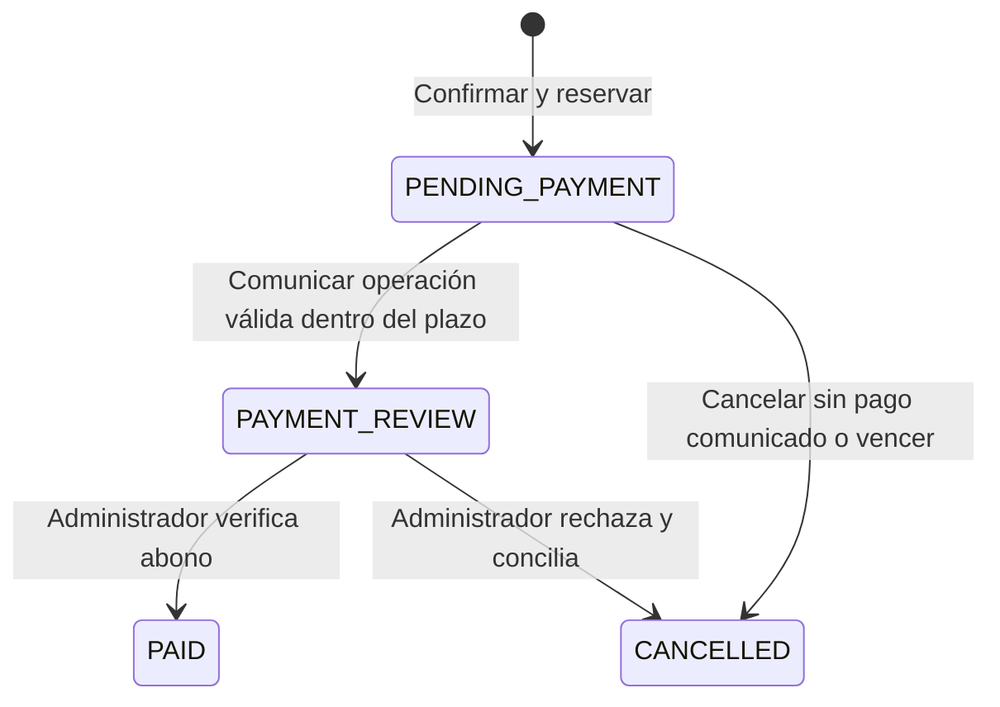

# ADR 0003 — Reserva antes del pago manual

Fecha de decisión: 2026-10-15 (America/Lima). Registro de cierre: 2026-10-16.
Estado: adoptada y verificada para S1-03; integración pendiente en PR #5.
Base: S1-02, commit `e8b72d8f41b36eec6d3317e127e531affe4309d5`. PR #4 pendiente de integrar.

## Decisión y secuencia
1. Entrega y resumen: lectura del catálogo/tarifa y firma del resumen. Sin instrucciones bancarias.
2. Confirmar y reservar: POST autenticado valida firma, cobertura, disponibilidad y datos de comprobante.
   Una transacción Serializable guarda pedido/items/pago pendiente, descuenta stock condicionalmente,
   registra movimientos y retira solo las líneas del carrito consumidas por esa confirmación.
3. Solo después del commit, `/pedidos/[number]/pagar` muestra el importe y destino del medio elegido.
   Lee el snapshot persistido del pedido, sin recalcular precios del catálogo.
4. Comunicar operación: POST del dueño cambia `PENDING_PAYMENT` → `PAYMENT_REVIEW` y el pago
   `PENDING` → `UNDER_REVIEW` atómicamente. No reserva ni limpia el carrito otra vez.
5. Aprobar conserva el stock reservado. Rechazar/cancelar/vencer libera una sola vez bajo condición de estado.

## Vencimiento y cancelación

La entrada reserva una vez; las salidas hacia CANCELLED liberan una vez. Comunicar y aprobar no descuentan stock.

`stockReservedAt`, `reservationExpiresAt` y `stockReleasedAt` identifican la reserva real.
El vencimiento se calcula al crear: ahora + MANUAL_PAYMENT_HOLD_MINUTES (15–1440; default 120).
Cambiar la variable después no altera reservas existentes. `reservationExpiredAt` distingue un vencimiento.
Solo un pedido pendiente, con reserva real y sin operación comunicada, puede vencer automáticamente.
Se comprueba al abrir instrucciones, al comunicar y en mantenimiento. El enlace GET no crea reservas;
puede liberar una reserva ya vencida mediante la misma operación protegida que usa mantenimiento.
La cancelación del cliente solo se permite antes de comunicar pago; una operación ya comunicada
requiere conciliación con la tienda. Si el cliente pagó pero vence/cancela antes de informar, debe
contactar a la tienda y no pagar de nuevo: el sistema no conoce un abono manual hasta comunicarlo.
Sin cron no hay garantía de liberación a la hora exacta: mantenimiento o acceso deben ejecutarse.

## Compatibilidad y alcance
La migración es aditiva. Pedidos anteriores en revisión/pagados/en preparación/enviados/entregados
se reconocen como stock ya reservado, sin volver a descontarlo ni asignarles vencimiento.
Un `PENDING_PAYMENT` antiguo sin marcador de reserva no recibe instrucciones; requiere revisión operativa.
No se deduce una reserva de ese estado por sí solo. Los pedidos cancelados/reembolsados se conservan.
Los importes anteriores de S1-02 y su firma se mantienen; banco/QR se leen de la configuración vigente.
Si el medio se deshabilita después de reservar, se ocultan instrucciones y se indica contactar a la tienda;
se permite comunicar un pago ya hecho contra la reserva válida para no perder la conciliación.

El límite de tres pendientes incluye reservas y revisiones, evitando retener inventario ilimitadamente.
Idempotencia persistida de creación sigue en S1-04. S1-05 ampliará pruebas de aprobación/rechazo concurrentes,
conciliación tardía y operación administrativa. Se adelanta aquí la exclusión de PAYMENT_REVIEW del
mantenimiento y la cancelación del cliente porque son necesarias para que el nuevo flujo sea coherente.

## Documentación y evidencia
Antes: este ADR y criterios S1-03. Durante: migración, servicios, pruebas de BD y recorrido autenticado.
Al cerrar: QA, capturas reales desktop/móvil, manifiesto de hashes, backlog, arquitectura y progreso.
Pruebas: rollback multi-producto, última unidad concurrente, plazo persistido, liberación única,
propiedad del pedido, precio congelado tras reservar y carrito modificado después sin perder cambios.
Resultado: 40 pruebas y 6 casos de navegador aprobados; migración verificada y 16 capturas conservadas.
Detalle de ejecución e incidencias: [QA S1-03](../testing/s1-03-reserva.md).
