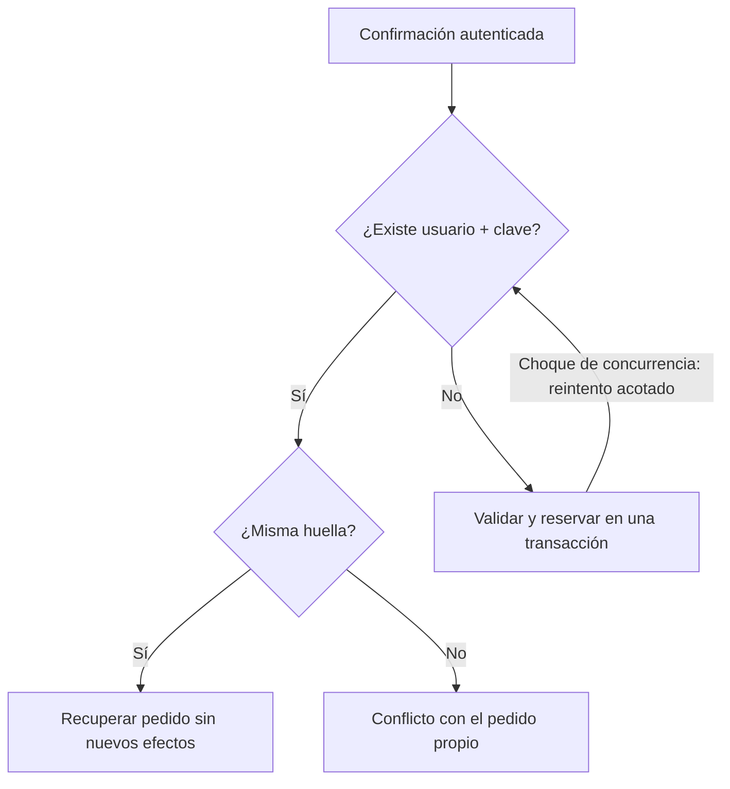

# ADR 0004 — Idempotencia persistida de confirmación

Fecha: 2026-10-16 (America/Lima). Estado: adoptada y verificada para S1-04; integración pendiente en PR #6.
Base: S1-03 `b35a57896ba06eb35402f5b4d404f3233846df95` (PR #5, pendiente de integración).

## Clave y contenido
El servidor deriva una clave `ck1:` + HMAC-SHA256 del usuario y la firma del resumen,
con dominio separado y NEXTAUTH_SECRET. Es estable mientras el mismo cliente vea el mismo
resumen; recargar o abrir otra pestaña no genera otra operación. La firma ya liga carrito,
IDs de líneas, cantidades, precios, dirección y tarifa. Una nueva compra con líneas nuevas
o un resumen cambiado obtiene otra clave. No se guardan datos fiscales en localStorage.

La orden guarda `checkoutKey` y `checkoutRequestHash`. La huella SHA-256 canónica incluye
versión/operación, usuario, firma del resumen, dirección, proveedor, comprobante y todos los
campos fiscales/notas aceptados. Entradas normalizadas con Zod, trim y opcionales vacíos
equivalentes a ausentes. Los campos monetarios del navegador y campos ajenos se ignoran.

## Regla transaccional

Un índice UNIQUE(userId, checkoutKey) garantiza a lo sumo una orden por operación/cliente.
Se lee esa clave ANTES de consultar carrito, precios, stock, límite de pendientes o proveedor:
- Mismo contenido: devolver ID/número de la orden existente, sin tocar stock, plazo, pagos o carrito.
- Contenido distinto: conflicto controlado y enlace al pedido propio; no sobrescribirlo ni reservar.
- Clave nueva: comprobar firma de clave/resumen y configuración del proveedor; crear orden,
  huella, reserva, pago y movimientos, y consumir líneas en la misma transacción Serializable.

P2034 se reintenta de forma acotada. P2002 del índice de checkout se resuelve leyendo la
orden ganadora y comparando su huella. Una transacción fallida no consume la clave ni deja
stock reservado. No se persiste una fila IN_PROGRESS separada que pueda quedar huérfana.
La disponibilidad del proveedor se verifica solo para crear; un reintento ya completado
se recupera aunque cambien catálogo/configuración/dirección o se haya vaciado/modificado el carrito.

## Recuperación y propiedad
Autenticación y validación de formato preceden a toda recuperación. La búsqueda siempre usa
usuario de sesión + clave; conocer la clave ajena no permite recuperar su orden. Una nueva clave
debe verificar su HMAC ligado al usuario/firma. Para una orden ya guardada se compara el contenido
persistido, sin depender de la clave de firma actual: una rotación del secreto no rompe ese reintento.

El resultado conserva el estado actual de la orden. Cancelar/vencer/aprobar no vuelve reutilizable
la clave ni renueva el plazo; la ruta privada muestra el estado vigente y oculta instrucciones si
ya no se puede pagar. La clave se conserva mientras exista la orden; no se introduce TTL/purga.
No se añaden claves retrospectivas a pedidos anteriores ni se deduplican datos históricos.

En navegador se conserva el formulario si falla la respuesta y se permite reenviar los mismos
datos. Se mantiene la acción nativa como alternativa sin JavaScript. El botón deshabilitado es
una ayuda de UX; la garantía está en PostgreSQL. Se probará pérdida de respuesta DESPUÉS del commit.
Un conflicto con la orden ya creada se muestra en su detalle, aunque el carrito esté vacío.

## Alcance y documentación
Migración aditiva 9, campos nullable para históricos, check de pareja/formato e índice compuesto.
Sin nuevas dependencias o servicios de pago. Sin cambios a Render ni fusión de main.
Antes: este ADR. Durante: esquema, lógica, contratos de migración y pruebas. Al cerrar: QA, capturas
desktop/móvil con manifiesto, arquitectura, backlog y punto de avance en el mismo PR.
Aceptación: reintento secuencial/concurrente devuelve una orden, respuesta perdida recuperable,
conflicto fiscal/proveedor/resumen, acceso ajeno rechazado, rollback y nueva compra explícita.
Revisión administrativa/conciliación ampliada sigue en S1-05.

Verificación: 53 pruebas, 10 casos de navegador, 9 migraciones y dos contratos SQL aprobados;
ocho capturas nuevas conservadas. Resultados y límites: [QA S1-04](../testing/s1-04-idempotencia.md).
