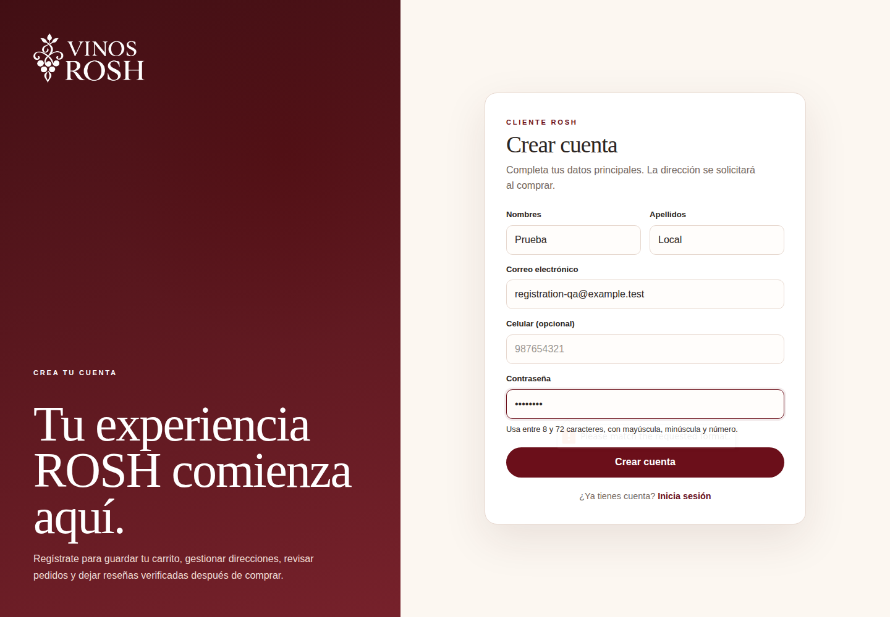
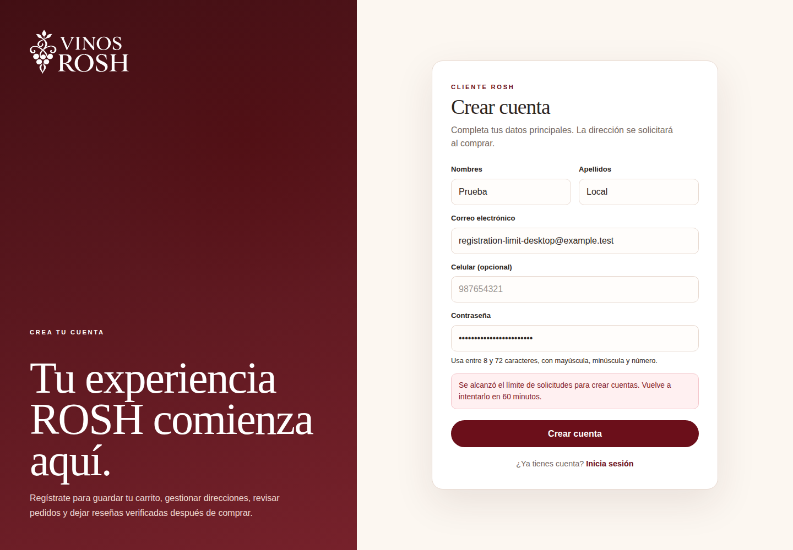
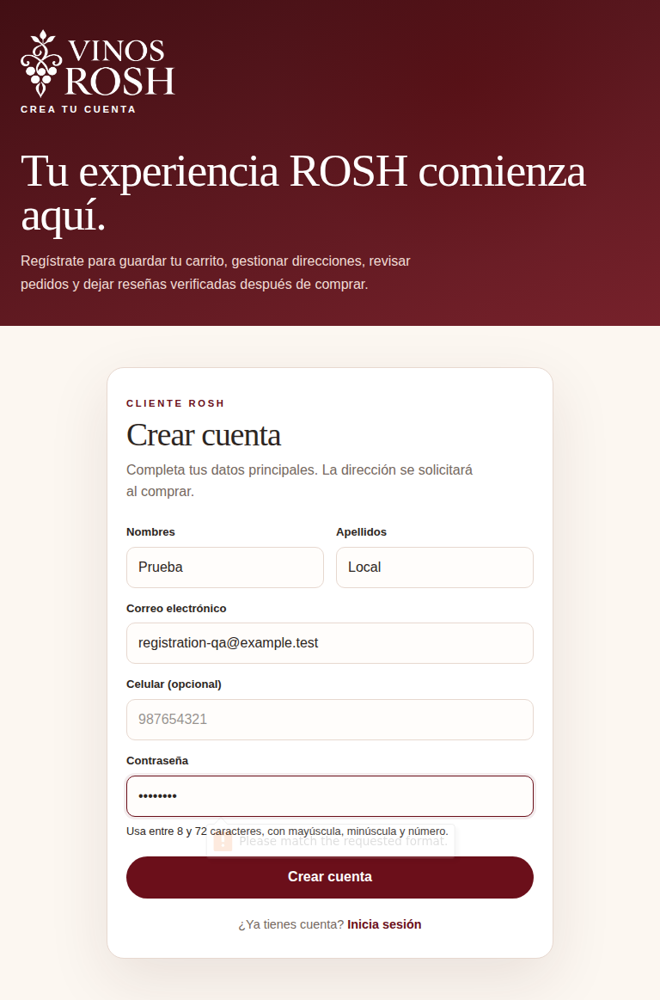
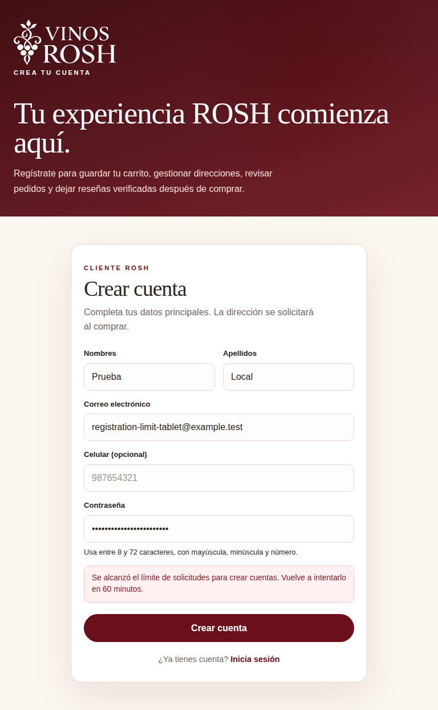

# Registro local — evidencia original

Fecha de revisión: 2026-10-22 (America/Lima). [PR #21](https://github.com/nagiseishiro123456-creator/vinos-rosh-ecommerce/pull/21).
Fuente: `715327c289853fb688c101e825f68f9ed57fe99b`, árbol `2f05a589d0dd387325df58f293c5eb4342be5f88`.
[CI 39864647078](https://github.com/nagiseishiro123456-creator/vinos-rosh-ecommerce/actions/runs/39864647078): **194/194 servidor y 76/76 navegador**, además de migraciones/contratos/restore y checks técnicos aprobados.

Ocho PNG originales, sin edición ni recodificación, exportados por los jobs Registration evidence. SHA-256, Git blob SHA, origen y dimensiones en [manifest.json](manifest.json). Google Chrome 155.0.8059.39 mediante el canal oficial de Playwright; la versión se registra en el run.

El aviso de 60 minutos demuestra la regla normal en el build production, después de seis solicitudes. El opt-in local de 60 solicitudes/10 minutos se comprueba en política y PostgreSQL. No se bloqueó una cuenta real ni se cambió una contraseña.

| Vista | Viewport | Reglas de contraseña | Espera del registro |
| --- | --- | --- | --- |
| Escritorio | 1440 × 1000 |  |  |
| Móvil | 390 × 844 |  |  |
| Móvil pequeño | 320 × 740 |  |  |
| Tablet | 768 × 1024 |  |  |

Las capturas son full-page; el alto del PNG puede superar el viewport. Hay datos sintéticos y contraseñas enmascaradas. Se revisaron visualmente el formulario estrecho y los estados de espera de móvil/tablet/escritorio; las aserciones de overflow se ejecutan en los cuatro tamaños.

Esta rama añade únicamente evidencia y este índice al código validado. No sustituye su cabecera de implementación, no modifica main/Render ni ejecuta migraciones. Los 192 PNG históricos permanecen intactos; esta colección añade ocho. [Guía de desbloqueo](../../../desarrollo-registro-local.md).
