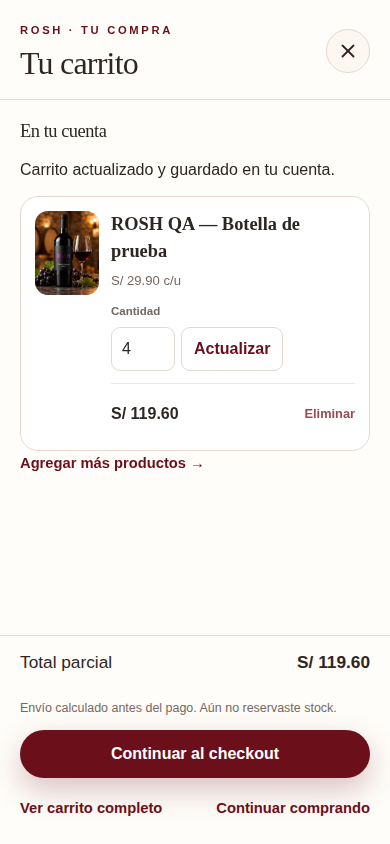
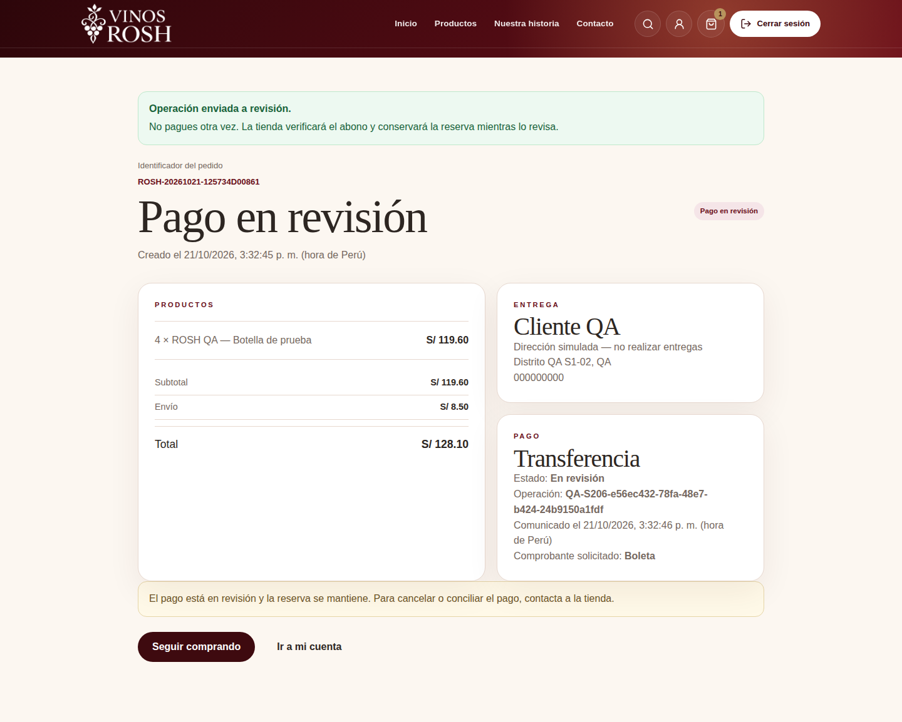

# Evidencias — Revisión e integración del Sprint 2

2026-10-21 (America/Lima). Fuente `3d6dd51a946fba9b8c337cb1a8b63bca0e38e461`,
[CI 39670639919](https://github.com/nagiseishiro123456-creator/vinos-rosh-ecommerce/actions/runs/39670639919), integrada sin cambios de árbol en
`d2efd04047bb0cc331efa6e004dba4fd927f842b`. [QA](../../../testing/revision-integracion-sprint-02.md) ·
[Manifiesto](manifest.json) · [Validación](validacion-ci.txt).

Seis PNG originales de Chromium y datos sintéticos, inspeccionados sin retoque/recompresión.
Los 186 anteriores permanecen intactos; total 192. Las imágenes tienen fuente/run/hashes;
el digest del ZIP se conserva solo como dato informado por GitHub.

| Estado | Escritorio 1440 px | Móvil 390 px |
| --- | --- | --- |
| 2 invitado + 3 cuenta; editado a 4 desde el panel, S/ 119.60 | [Ver](ci-desktop-66-carrito-integrado-panel.png) | [Ver](ci-mobile-66-carrito-integrado-panel.png) |
| Reserva de 4, total con envío S/ 128.10; contador vacío | [Ver](ci-desktop-67-reserva-desde-seleccion.png) | [Ver](ci-mobile-67-reserva-desde-seleccion.png) |
| Pago en revisión y selección posterior de 1 conservada en header | [Ver](ci-desktop-68-pago-en-revision-carrito-nuevo.png) | [Ver](ci-mobile-68-pago-en-revision-carrito-nuevo.png) |

La imagen 67 es una reserva deliberada de QA con stock 10→6. La 68 muestra operación
comunicada, sin pago confirmado ni otra reserva. El inventario/cantidad/revisión y la
conservación del carrito posterior se comprueban en BD; no se deducen solo de la imagen.

| Referencia móvil S2-01 | Comparación de cierre |
| --- | --- |
| [Carrito inicial](../s2-01/base-mobile-05-carrito-exacto.png) | El panel nuevo comparte estado; footer y acciones legibles, sin la barra inferior que tapaba el resumen. |
| [Reserva inicial](../s2-01/base-mobile-09-reserva-confirmada.png) | ID separado de fecha; sin superposición, moneda/importe legibles. |
| [Revisión inicial](../s2-01/base-mobile-10-operacion-en-revision.png) | Estado de pago y selección nueva se distinguen; importes sin corte y controles en flujo. |

Los valores de cantidades/precio/fechas son distintos entre fixtures; no son métricas de
conversión/rendimiento. Las imágenes 67/68 son full-page; dimensiones exactas en manifiesto.
Los casos anteriores siguen verificando 320/768 px, teclado, movimiento reducido y estados
de error. No se atribuye lector de pantalla, contraste medido, zoom, Safari/Firefox ni UAT.

