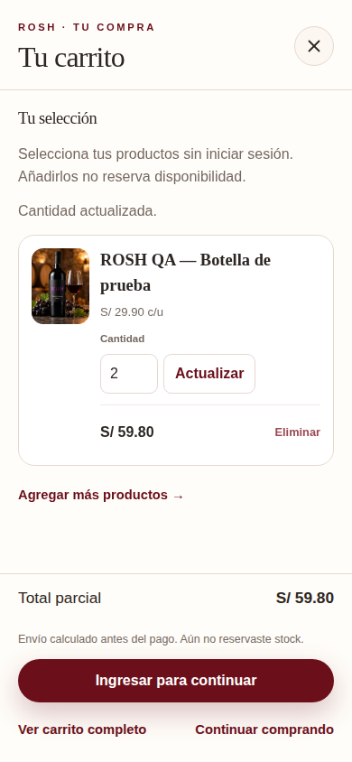
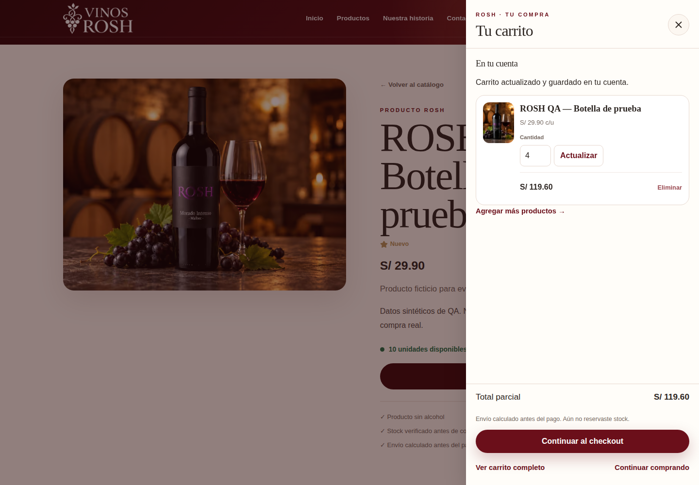

# Evidencias — S2-05

2026-10-20 (America/Lima). Fuente `f06b4ad41c424216dc67f45b7b904a64421c184d`,
[CI 39493524715](https://github.com/nagiseishiro123456-creator/vinos-rosh-ecommerce/actions/runs/39493524715).

**36 PNG originales inspeccionados**, de la aplicación compilada en GitHub Actions con
PostgreSQL QA aislado y Chromium de Playwright. Productos, cuentas y direcciones sintéticos.
Sin retoque/recompresión ni imágenes generadas. Las 150 capturas anteriores quedan intactas.

[Manifiesto de procedencia/dimensiones/hashes](manifest.json) ·
[Validación CI](validacion-ci.txt) · [Coste JS de apertura](bundle-apertura.json) ·
[QA y límites](../../../testing/s2-05-carrito-lateral.md).

| Estado | Escritorio 1440 px | Móvil 390 px |
| --- | --- | --- |
| Vacío; apertura con movimiento normal y foco contenido | [Ver](ci-desktop-52-panel-vacio.png) | [Ver](ci-mobile-52-panel-vacio.png) |
| Añadido como invitado: 1 unidad, S/ 29.90 | [Ver](ci-desktop-53-panel-invitado.png) | [Ver](ci-mobile-53-panel-invitado.png) |
| Cantidad actualizada: 2 unidades, S/ 59.80 | [Ver](ci-desktop-54-panel-cantidad.png) | [Ver](ci-mobile-54-panel-cantidad.png) |
| Respuesta perdida después del commit; operación incierta y checkout bloqueado | [Ver](ci-desktop-55-panel-respuesta-perdida.png) | [Ver](ci-mobile-55-panel-respuesta-perdida.png) |
| Mismo UUID recuperado: 6 unidades, S/ 179.40 | [Ver](ci-desktop-56-panel-recuperado.png) | [Ver](ci-mobile-56-panel-recuperado.png) |
| Cuenta y otra pestaña sincronizadas: 4 unidades, S/ 119.60 | [Ver](ci-desktop-57-panel-cuenta-sincronizada.png) | [Ver](ci-mobile-57-panel-cuenta-sincronizada.png) |
| Lectura retenida; precios/total por verificar | [Ver](ci-desktop-58-panel-cargando.png) | [Ver](ci-mobile-58-panel-cargando.png) |
| Confirmación retenida; cantidad confirmada anterior hasta recibir respuesta | [Ver](ci-desktop-59-panel-guardando.png) | [Ver](ci-mobile-59-panel-guardando.png) |
| Stock 0; aviso y checkout bloqueado, eliminación disponible | [Ver](ci-desktop-60-panel-sin-disponibilidad.png) | [Ver](ci-mobile-60-panel-sin-disponibilidad.png) |
| Error de red recuperable; verificación antes de continuar | [Ver](ci-desktop-61-panel-error-red.png) | [Ver](ci-mobile-61-panel-error-red.png) |
| 401; datos privados eliminados y acceso al ingreso | [Ver](ci-desktop-62-panel-sesion-vencida.png) | [Ver](ci-mobile-62-panel-sesion-vencida.png) |
| Entrega actualizada tras editar: 2 unidades, total con envío S/ 68.30 | [Ver](ci-desktop-63-checkout-tras-panel.png) | [Ver](ci-mobile-63-checkout-tras-panel.png) |
| Reserva sintética confirmada; instrucciones posteriores, contador vacío | [Ver](ci-desktop-64-reserva-tras-panel.png) | [Ver](ci-mobile-64-reserva-tras-panel.png) |
| Cambio de sesión; selección anterior oculta y acción rechazada | [Ver](ci-desktop-65-panel-cuenta-distinta.png) | [Ver](ci-mobile-65-panel-cuenta-distinta.png) |

| Tamaño adicional | Vacío | Cantidad | Sin disponibilidad | Sesión vencida |
| --- | --- | --- | --- | --- |
| 320 px | [Ver](ci-small-mobile-52-panel-vacio.png) | [Ver](ci-small-mobile-54-panel-cantidad.png) | [Ver](ci-small-mobile-60-panel-sin-disponibilidad.png) | [Ver](ci-small-mobile-62-panel-sesion-vencida.png) |
| 768 px | [Ver](ci-tablet-52-panel-vacio.png) | [Ver](ci-tablet-54-panel-cantidad.png) | [Ver](ci-tablet-60-panel-sin-disponibilidad.png) | [Ver](ci-tablet-62-panel-sesion-vencida.png) |

Los viewports son 1440×1000, 390×844, 320×740 y 768×1024. Las imágenes 63/64 son
full-page y tienen otra altura, registrada en el manifiesto. No se incluyen duplicados
de attachments ni capturas de ejecuciones fallidas. La imagen 52 usa movimiento normal;
53/54 siguen cambios de preferencia en vivo; los otros escenarios usan movimiento reducido.

La imagen 64 corresponde a una **reserva deliberada de 2 unidades en QA**, después de
confirmar S/ 68.30 con envío. Stock pasa de 10 a 8 y el carrito se consume. No implica
pago recibido ni una reserva al abrir, añadir, editar o unir el carrito. Esos casos
comprueban stock intacto y ausencia de pedidos en BD.

La revisión visual comprueba jerarquía, nombre/precio, mensajes, footer, CTA y privacidad.
La distribución estrecha observada en la ejecución anterior se corrigió; la geometría
ahora exige al menos 160 px para el nombre y filas propias para cantidad y total.
El cuerpo del panel puede desplazarse internamente en pantallas cortas; el footer queda visible.

Los hashes SHA-256/dimensiones se verificaron sobre los bytes recuperados del exportador
de CI. Al guardar, el SHA del blob Git coincide con el calculado en CI. El digest del ZIP
se conserva **como dato informado por GitHub**, sin afirmar descarga/verificación local del ZIP.
El artefacto completo de CI tiene caducidad; estos 36 PNG permanecen versionados en Git.

Una imagen no prueba una transacción ni el orden de foco: esas garantías se apoyan en
aserciones de servidor/navegador. No equivale a certificación WCAG, lector de pantalla,
Safari/Firefox, dispositivo real ni aceptación comercial. Ver límites en QA.

