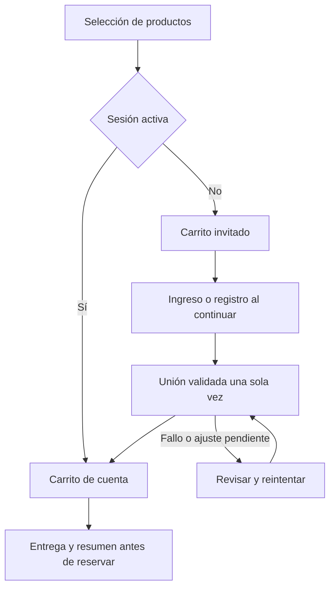

# Sprint 2 — Recorrido de compra y diagnóstico UX

Revisión: 2026-10-18 (America/Lima). Base: `16074e1fd97fc62f51fb863cfb3f46230a3df3d2`.
S2-01 define el diseño funcional; este documento no afirma que las mejoras estén implementadas.
[Plan e historias](../sprints/fase-2-sprint-02.md) · [Evidencias](../evidencias/sprint-02/s2-01/README.md).

## Recorrido actual comprobado en código

| Paso | Comportamiento actual | Fuente |
| --- | --- | --- |
| Ver producto | Precio, descripción, stock y botón; sin stock bloquea añadir. | `src/app/productos/[slug]/page.tsx` |
| Añadir sin sesión | Redirige a ingreso con callback a la ficha; no guarda la selección. Tras entrar debe volver a añadir. | `src/modules/cart/actions.ts` |
| Añadir con sesión | Guarda por usuario en Prisma y redirige a `/carrito`; header suma unidades. | `src/modules/cart/actions.ts`, `src/components/store-header.tsx` |
| Abrir carrito sin sesión | Redirige al ingreso; no existe carrito invitado ni panel lateral. | `src/app/carrito/page.tsx`, `src/components/site-header.tsx` |
| Editar carrito | Formularios de actualizar/eliminar; cantidades 1–99 y ajuste por stock. Algunas entradas inválidas retornan sin mensaje específico. | `src/modules/cart/actions.ts` |
| Entrar / registrarse | Login usa callback interno básico. Enlace a registro no lo conserva y registro termina en `/mi-cuenta`. | `src/app/iniciar-sesion/page.tsx`, `src/app/registrarse/page.tsx` |
| Entrega | Dirección guardada o nueva, cobertura por zona y resumen; requiere cuenta. | `src/app/checkout/page.tsx`, `src/components/checkout-address-selector.tsx` |
| Confirmar | Método/comprobante/notas y botón; el resumen completo es un aside posterior al formulario en DOM. | `src/app/checkout/pago/page.tsx`, `src/components/reservation-form.tsx` |
| Reservar | Transacción servidor con dinero exacto, stock e identidad; solo después se muestran instrucciones privadas. | `src/modules/orders/manual-order-service.ts` |
| Comunicar pago | Se envía operación a revisión; no se afirma que el banco confirmó el abono. | `src/modules/orders/reservation-service.ts`, `src/components/manual-payment-instructions.tsx` |

Los tests de main comprueban el recorrido autenticado con datos sintéticos. La redirección
de añadir anónimo y la pérdida del destino de registro se constatan por código; no se
atribuyen a una ejecución exploratoria nueva en este trabajo.

## Hallazgos y trazabilidad

Prioridad significa orden para este sprint, no una medición de pérdida de ventas.
Los overlays visibles en PNG requieren además comprobar scroll, foco y hit testing
en el viewport durante S2-02; una captura full-page fija controles en la posición capturada.

| ID | Observación verificada | Evidencia | Acción / historia |
| --- | --- | --- | --- |
| UX-201 | Barra inferior y WhatsApp se superponen con texto, importes o zonas de acciones en móvil. | Mobile 03, 05, 06, 07 y 09; CSS fijo de navegación/FAB. | Alta, S2-02: política de visibilidad/espacio y pruebas de geometría/foco. |
| UX-202 | Confirmación móvil presenta el botón antes del resumen completo; dificulta revisar el conjunto antes de reservar. | Mobile 07, 08; orden del DOM en página de pago. | Alta, S2-02: resumen antes de acción; mantener un solo formulario. |
| UX-203 | Moneda y valor se separan en líneas de producto. También ocurre en escritorio en aside estrecho. | Desktop/mobile 07, 08 y 09; mobile 10. | Media, S2-02: unidad monetaria indivisible sin ocultar nombre ni desbordar. |
| UX-204 | El visitante debe identificarse antes de preparar la selección. | `requireUserId` y redirección de carrito. | Alta, S2-03: selección local consultada contra servidor. |
| UX-205 | Crear cuenta pierde el destino del checkout/producto; el ingreso no une selecciones. | Páginas de login/registro; esquema Cart con userId obligatorio. | Alta, S2-04: continuidad e importación idempotente y autorizada. |
| UX-206 | El icono de carrito y añadir abandonan el contexto; no existe drawer. | Header/action; capturas de carrito a página completa. | Mejora, S2-05: panel accesible y página completa coherentes. |
| UX-207 | Las direcciones se implementan con botones role=radio sin navegación por flechas ni gestión de tabIndex de radiogroup. | `checkout-address-selector.tsx`; observación de código. | Media, S2-02: preferir radios nativos o completar el patrón y probarlo. |
| UX-208 | `En revisión` y `Boleta` ya aparecen traducidos; un pendiente antiguo quedó resuelto. | Desktop/mobile 10 y página de pedido. | Conservar como regresión, no duplicar tarea de traducción. Revisar otros mensajes según aparezcan. |
| UX-209 | El prefijo interno ROSH-20261018 puede diferir de la fecha de creación 17/10 en Perú. | Desktop/mobile 09–10; generación con zona del proceso y fecha mostrada en Lima. | Baja, S2-02: distinguir ID de fecha; conservar identificadores históricos. |
| UX-210 | Añadir/actualizar puede retornar sin feedback y no hay estados compartidos de guardado/error del carrito. | Acciones de carrito y formularios actuales. | S2-03–S2-05: respuestas comprensibles, anuncio de resultado y recuperación. |
| UX-211 | Añadir lee la cantidad y luego escribe un valor absoluto en otra consulta; dos solicitudes pueden sobrescribir el incremento de la otra. Riesgo por código, no reproducido aquí. | `existing`/`nextQuantity` y upsert en acciones de carrito. | S2-04/S2-05: prueba concurrente y actualización protegida del carrito de cuenta; no confundirlo con reserva de stock. |

Las imágenes no prueban por sí solas conformidad de contraste, lector de pantalla,
rendimiento ni ausencia de solapamiento a otros niveles de scroll. Estos aspectos
figuran en los criterios futuros, no como resultados ya aprobados.

## Recorrido objetivo

El siguiente diagrama describe la bifurcación de identidad y la puerta de unión,
todavía propuesta. El proceso de reserva/pago posterior mantiene las reglas de Sprint 1.

Al confirmar H, el servidor relee cantidades/precios/cobertura y ejecuta la reserva
idempotente existente. Las instrucciones de pago siguen requiriendo una orden persistida.
Se permite revisar productos aunque la unión haya fallado; no avanzar al checkout con
una importación pendiente que pueda reaplicarse después de reservar.

## Jerarquía de pantalla propuesta

| Pantalla | Orden y acciones previstas | Estados que debe explicar |
| --- | --- | --- |
| Producto | Imagen, nombre, precio, información comercial real, disponibilidad y añadir; reseñas después. Mantener CTA inmediato, sin animaciones que retrasen su uso. | Disponible, agotado/retirado, añadiendo, añadido y fallo recuperable. |
| Carrito página/panel | Nombre/imagen, precio, cantidad editable, eliminar, subtotal; indicar que envío y disponibilidad se revalidan; continuar o seguir comprando. | Vacío, validando, ajustado, error de red, almacenamiento no persistente y sesión cambiada. |
| Identificación | Ingreso/registro con destino de retorno preservado y resumen breve de selección; finalizar unión antes de ir a entrega. | Validación, credenciales erróneas, cuenta creada sin auto-login, unión pendiente y conflicto. |
| Entrega | Selección/nueva dirección, cobertura, tarifa y resumen; revisar pedido. No presentar 0 de envío como cobertura gratuita cuando falta tarifa. | Sin dirección, sin cobertura, stock cambiado, guardando y errores por campo. |
| Confirmación | Entrega/productos/importes, método, comprobante y notas; total junto a confirmar. Un mismo orden accesible en DOM y móvil. | Método indisponible, resumen cambiado, procesando y respuesta perdida. |
| Instrucciones | Pedido ya reservado, importe/plazo, medio manual y comunicar operación. | Pendiente, vencido/cancelado, operación enviada y error recuperable. |
| Pedido | Estado comercial, productos/importe, entrega y pago; acción siguiente explícita. | Revisión no equivale a confirmado; no repetir pago. ID separado de fecha en Perú. |

La interfaz respeta el carácter de bebidas de uva sin alcohol definido en el código.
La botella QA y los datos bancarios ficticios son fixtures, no catálogo aprobado.

## Reglas propuestas de estado y recuperación

- El invitado solo persiste IDs/cantidades; el precio viene de consultas servidor y se
  valida de nuevo al confirmar. Carrito no significa reserva.
- Cada unión tiene identidad y contenido ligados al usuario, guardados atómicamente
  con su resultado. S2-04 debe concretar esto en ADR y tests, incluyendo el esquema si aplica.
- Aplicar 2 + 1 = 3 una vez. Con stock 2, mostrar ajuste a 2; producto desactivado se
  excluye con motivo. Conservar información suficiente para explicar lo descartado.
- No borrar selección nueva cuando llega la respuesta de una selección anterior.
  Reintentos o pestañas que comparten la misma importación recuperan el mismo resultado.
- Hasta confirmar unión, evitar mandar nuevas compras al checkout con estado ambiguo.
  Tras logout, el carrito de la cuenta anterior no pasa al navegador como invitado.
- Almacenamiento inaccesible: mantener estado en memoria y avisar de su duración.
  No usar precios, totales o un userId enviados por el navegador como autorización.
- El panel no vuelve a ejecutar la reserva ni copia su estado transaccional. Error al
  guardar en cuenta requiere recuperar el estado servidor y explicar qué ocurrió.

## Accesibilidad, Motion y tamaños

S2-02 introduce comprobaciones a 320, 390, 768 y 1440 px; las capturas base solo cubren
390×844 y 1440×1000 de viewport. Los PNG son full-page y pueden ser más altos.
Probar textos largos, cantidades máximas e importes grandes dentro del límite vigente.

Teclado: orden natural, foco visible, selección de direcciones y errores asociados;
el foco debe poder desplazarse al control sin quedar oculto por elementos fijos.
Objetivo de diseño para acciones principales: 44×44 px mínimo, sin afirmar con ello
una certificación de accesibilidad. Probar zoom de texto y la ruta crítica con lector
de pantalla en el entorno que se use; declarar lo no ejecutado.

Drawer futuro: diálogo con nombre, foco inicial/contenido, Escape, retorno al disparador,
fondo inerte y scroll restaurado. Motion solo para entrada/salida, `'use client'` y
`useReducedMotion`; reducir/desactivar desplazamiento según preferencia. Sin parallax
ni scroll complejo en páginas transaccionales; Home inmersivo queda en Sprint 5.

## Paso propuesto en el diagnóstico inicial: S2-02

Reproducir con viewport/scroll reales UX-201/202/203/207, corregir jerarquía y espacio
sin alterar totales/stock, capturar los mismos ocho estados antes/después y añadir
aserciones pertinentes de layout/foco. Guardar resultados y defectos nuevos en QA de
S2-02, actualizar progreso y revisar el PR antes de seguir con carrito invitado.

## Actualización S2-02 — 2026-10-19

Las observaciones anteriores conservan la base del diagnóstico. S2-02 implementa
correcciones de UX-201/202/203/207/209 en una rama dependiente de S2-01. Header y
ayuda en flujo; barra inferior oculta en el embudo; consentimiento sin posición fija;
resumen anterior al formulario; radios nativos y foco; dinero sin cortes y nombres
con espacio legible. No se alteran números históricos ni lógica transaccional.
[Resultados y límites](../testing/s2-02-ux-movil.md). CI oficial aprobada sobre
`9c59839…`: 67/67 servidor y 20/20 navegador. Siguiente paso: ADR y carrito invitado
de S2-03; la revisión e integración del incremento siguen pendientes.
Los hallazgos de carrito invitado/unión/panel siguen pendientes para sus historias.
